# MindQuest Database — Entity Relationship Diagram (ERD)

> [!NOTE]
> Generated from [schema.sql](file:///c:/Users/ADMIN/OneDrive/Desktop/MindQuest1/sql/schema.sql) — **30+ tables**, all foreign key relationships shown.

---

## 📊 Full ERD

```mermaid
erDiagram

    branches {
        INT id PK
        NVARCHAR name UK
        BIT is_archived
        DATETIME2 created_at
    }

    subjects {
        INT id PK
        NVARCHAR name UK
        NVARCHAR category
        NVARCHAR image_path
        BIT is_archived
    }

    users {
        INT id PK
        NVARCHAR user_id UK
        NVARCHAR role
        INT branch_id FK
        INT assistant_scope_branch_id FK
        NVARCHAR password_hash
        NVARCHAR first_name
        NVARCHAR last_name
        NVARCHAR email
        NVARCHAR education_level_group
        INT accepted_submission_id FK
        NVARCHAR status
        BIT is_archived
    }

    submissions {
        INT id PK
        NVARCHAR submission_type
        INT branch_id FK
        NVARCHAR first_name
        NVARCHAR last_name
        NVARCHAR email
        NVARCHAR status
        BIT archived
    }

    notifications {
        INT id PK
        INT submission_id FK
        NVARCHAR title
        BIT is_read
    }

    user_subject_assignments {
        INT id PK
        INT student_id FK
        INT tutor_id FK
        INT subject_id FK
        INT branch_id FK
        INT accepted_by FK
        NVARCHAR time_slot
        NVARCHAR preferred_days
        DATE start_date
        DATE end_date
        BIT is_archived
    }

    attendance {
        INT id PK
        INT student_id FK
        INT tutor_id FK
        INT subject_id FK
        DATE attendance_date
        NVARCHAR status
    }

    billing {
        INT id PK
        INT student_id FK "UNIQUE"
        DECIMAL full_bill
        DECIMAL partial_payment
        DECIMAL for_settlement
        NVARCHAR payment_status
        INT posted_by FK
    }

    payment_history {
        INT id PK
        INT billing_id FK
        INT student_id FK
        DECIMAL amount
        INT recorded_by FK
    }

    payment_entries {
        INT id PK
        INT billing_id FK
        INT student_id FK
        INT sequence_no
        DECIMAL amount
        NVARCHAR payment_method
        INT recorded_by FK
        INT payment_request_id FK
        BIT is_locked
    }

    payment_requests {
        INT id PK
        INT student_id FK
        INT billing_id FK
        INT branch_id FK
        DECIMAL amount
        NVARCHAR status
        INT processed_by FK
    }

    soa_posts {
        INT id PK
        INT billing_id FK
        INT student_id FK
        INT branch_id FK
        INT created_by FK
    }

    online_payments {
        INT id PK
        INT student_id FK
        INT billing_id FK
        DECIMAL amount
        NVARCHAR status
        NVARCHAR checkout_url
    }

    subject_resources {
        INT id PK
        INT subject_id FK
        INT tutor_id FK
        INT assigned_student_id FK
        INT source_resource_id FK
        NVARCHAR title
        NVARCHAR module_origin
        NVARCHAR difficulty_level
        BIT is_archived
    }

    modules {
        INT id PK
        INT subject_id FK
        NVARCHAR level
        NVARCHAR title
        NVARCHAR grade_level
        INT uploaded_by FK
        BIT is_archived
    }

    module_reads {
        INT id PK
        INT student_id FK
        INT resource_id FK
        INT subject_id FK
        DATETIME2 read_at
    }

    messages {
        INT id PK
        INT sender_id FK
        INT receiver_id FK
        NVARCHAR body
        BIT is_seen
    }

    assessments {
        INT id PK
        NVARCHAR title
        NVARCHAR assessment_type
        INT branch_id FK
        INT assigned_student_id FK
        INT created_by FK
        INT subject_id FK
        INT assigned_by_tutor_id FK
        INT cycle_id FK
        NVARCHAR assessment_origin
    }

    assessment_questions {
        INT id PK
        INT assessment_id FK
        NVARCHAR question_text
        NVARCHAR correct_answer
        NVARCHAR question_type
    }

    assessment_results {
        INT id PK
        INT assessment_id FK
        INT student_id FK
        INT score
        DECIMAL percentage
        NVARCHAR level
        INT attempt_id FK
    }

    assessment_templates {
        INT id PK
        INT subject_id FK
        NVARCHAR title
        NVARCHAR assessment_type
        INT created_by FK
        BIT is_archived
    }

    assessment_template_questions {
        INT id PK
        INT template_id FK
        NVARCHAR question_text
        NVARCHAR correct_answer
    }

    assessment_attempts {
        INT id PK
        INT assessment_id FK
        INT student_id FK
        INT attempt_number
        DECIMAL percentage
        NVARCHAR level
        BIT is_auto_submitted
    }

    student_assessment_answers {
        INT id PK
        INT attempt_id FK
        INT question_id FK
        NVARCHAR student_answer
        BIT is_correct
    }

    assessment_anti_cheat_logs {
        INT id PK
        INT assessment_id FK
        INT student_id FK
        INT attempt_id FK
        NVARCHAR event_type
    }

    assessment_requests {
        INT id PK
        INT student_id FK
        INT tutor_id FK
        INT subject_id FK
        INT resource_id FK
        NVARCHAR status
    }

    tutor_assessments {
        INT id PK
        INT subject_id FK
        INT module_id FK
        INT tutor_id FK
        NVARCHAR title
        NVARCHAR purpose
        NVARCHAR grade_level
        BIT is_archived
    }

    tutor_assessment_questions {
        INT id PK
        INT assessment_id FK
        NVARCHAR question_text
        NVARCHAR question_type
        NVARCHAR correct_answer
    }

    tutor_question_options {
        INT id PK
        INT question_id FK
        NVARCHAR option_label
        NVARCHAR option_text
    }

    tutor_assessment_submissions {
        INT id PK
        INT assessment_id FK
        INT student_id FK
        INT score
        DECIMAL percentage
        BIT is_auto_submitted
        INT violation_count
    }

    tutor_student_answers {
        INT id PK
        INT submission_id FK
        INT question_id FK
        NVARCHAR student_answer
        BIT is_correct
    }

    assessment_violations {
        INT id PK
        INT assessment_id FK
        INT student_id FK
        INT submission_id FK
        NVARCHAR violation_type
    }

    student_learning_cycles {
        INT id PK
        INT student_id FK
        INT subject_id FK
        INT resource_id FK
        INT assessment_id FK
        INT attempt_id FK
        NVARCHAR status
    }

    student_subject_levels {
        INT id PK
        INT student_id FK
        INT subject_id FK
        NVARCHAR level
        INT pre_assessment_id FK
    }

    ai_generation_logs {
        INT id PK
        NVARCHAR generation_type
        INT student_id FK
        INT subject_id FK
        INT resource_id FK
        INT assessment_id FK
    }

    otps {
        INT id PK
        INT user_id FK
        NVARCHAR otp_code
        DATETIME2 expires_at
        INT failed_attempts
    }

    email_otps {
        INT id PK
        NVARCHAR email
        NVARCHAR purpose
        DATETIME2 expires_at
    }

    trusted_devices {
        INT id PK
        INT user_id FK
        NVARCHAR device_token
        NVARCHAR device_fingerprint
    }

    tutor_year_levels {
        INT id PK
        INT tutor_id FK
        NVARCHAR year_level
    }

    subject_enrollment_requests {
        INT id PK
        INT student_id FK
        INT subject_id FK
        INT branch_id FK
        NVARCHAR status
        INT decided_by FK
    }

    tutor_schedule_applications {
        INT id PK
        INT student_id FK
        INT tutor_id FK
        INT subject_id FK
        INT branch_id FK
        NVARCHAR time_slot
        NVARCHAR preferred_days
        NVARCHAR status
    }

    focus_handouts {
        INT id PK
        INT student_id FK
        INT subject_id FK
        INT tutor_id FK
        INT submission_id FK
        INT assessment_id FK
        NVARCHAR title
    }

    app_notifications {
        INT id PK
        NVARCHAR notification_type
        NVARCHAR title
        INT recipient_user_id FK
        INT branch_id FK
        INT read_by FK
        BIT is_read
    }

    assistant_rosters {
        INT id PK
        INT assistant_id FK
        INT member_id FK
        INT branch_id FK
        NVARCHAR member_role
    }

    assistant_admin_profiles {
        INT id PK
        NVARCHAR first_name
        NVARCHAR last_name
        INT user_id FK
        INT created_by FK
        BIT is_archived
    }

    %% ===== CORE RELATIONSHIPS =====

    branches ||--o{ users : "branch_id"
    branches ||--o{ submissions : "branch_id"
    branches ||--o{ user_subject_assignments : "branch_id"
    branches ||--o{ soa_posts : "branch_id"
    branches ||--o{ payment_requests : "branch_id"
    branches ||--o{ app_notifications : "branch_id"
    branches ||--o{ assistant_rosters : "branch_id"
    branches ||--o{ subject_enrollment_requests : "branch_id"

    users ||--o{ user_subject_assignments : "student_id / tutor_id"
    users ||--o{ attendance : "student_id / tutor_id"
    users ||--|| billing : "student_id"
    users ||--o{ messages : "sender_id / receiver_id"
    users ||--o{ otps : "user_id"
    users ||--o{ trusted_devices : "user_id"
    users ||--o{ tutor_year_levels : "tutor_id"

    submissions ||--o{ notifications : "submission_id"
    users ||--o| submissions : "accepted_submission_id"

    subjects ||--o{ user_subject_assignments : "subject_id"
    subjects ||--o{ attendance : "subject_id"
    subjects ||--o{ subject_resources : "subject_id"
    subjects ||--o{ modules : "subject_id"
    subjects ||--o{ assessments : "subject_id"
    subjects ||--o{ assessment_templates : "subject_id"
    subjects ||--o{ tutor_assessments : "subject_id"
    subjects ||--o{ student_subject_levels : "subject_id"
    subjects ||--o{ student_learning_cycles : "subject_id"
    subjects ||--o{ subject_enrollment_requests : "subject_id"
    subjects ||--o{ focus_handouts : "subject_id"

    billing ||--o{ payment_history : "billing_id"
    billing ||--o{ payment_entries : "billing_id"
    billing ||--o{ soa_posts : "billing_id"
    billing ||--o{ online_payments : "billing_id"
    billing ||--o{ payment_requests : "billing_id"

    payment_requests ||--o| payment_entries : "payment_request_id"

    subject_resources ||--o{ module_reads : "resource_id"
    subject_resources ||--o| subject_resources : "source_resource_id"

    modules ||--o{ tutor_assessments : "module_id"

    assessments ||--o{ assessment_questions : "assessment_id"
    assessments ||--o{ assessment_results : "assessment_id"
    assessments ||--o{ assessment_attempts : "assessment_id"
    assessments ||--o{ assessment_anti_cheat_logs : "assessment_id"

    assessment_templates ||--o{ assessment_template_questions : "template_id"
    assessment_attempts ||--o{ student_assessment_answers : "attempt_id"
    assessment_questions ||--o{ student_assessment_answers : "question_id"

    tutor_assessments ||--o{ tutor_assessment_questions : "assessment_id"
    tutor_assessments ||--o{ tutor_assessment_submissions : "assessment_id"
    tutor_assessments ||--o{ assessment_violations : "assessment_id"

    tutor_assessment_questions ||--o{ tutor_question_options : "question_id"
    tutor_assessment_questions ||--o{ tutor_student_answers : "question_id"

    tutor_assessment_submissions ||--o{ tutor_student_answers : "submission_id"
    tutor_assessment_submissions ||--o{ assessment_violations : "submission_id"
    tutor_assessment_submissions ||--o{ focus_handouts : "submission_id"
```

---

## 📋 Table Summary by Domain

### 👤 User & Auth (6 tables)
| Table | Purpose |
|---|---|
| `branches` | Tutorial center branches |
| `users` | All system users (admin, admin_assistant, student, tutor) |
| `submissions` | Registration applications |
| `otps` | Login OTP codes |
| `email_otps` | Email verification OTPs |
| `trusted_devices` | Remembered browser/device tokens |

### 📚 Subjects & Modules (7 tables)
| Table | Purpose |
|---|---|
| `subjects` | Available tutorial subjects |
| `user_subject_assignments` | Student↔Tutor↔Subject enrollment |
| `subject_resources` | Learning resources per subject |
| `modules` | Admin-uploaded modules per subject + level + grade |
| `module_reads` | Tracks which modules a student has read |
| `subject_enrollment_requests` | Student requests to enroll in a subject |
| `tutor_schedule_applications` | Student applies for a tutor's time slot |

### 📝 Assessments — Admin/AI System (7 tables)
| Table | Purpose |
|---|---|
| `assessments` | Admin/AI-created assessments |
| `assessment_questions` | Questions for admin assessments |
| `assessment_results` | Final score per student per assessment |
| `assessment_templates` | Reusable assessment templates |
| `assessment_template_questions` | Questions in templates |
| `assessment_attempts` | Each attempt a student makes |
| `student_assessment_answers` | Per-question answers per attempt |

### 📝 Assessments — Tutor System (6 tables)
| Table | Purpose |
|---|---|
| `tutor_assessments` | Tutor-created assessments (pre/activity/post) |
| `tutor_assessment_questions` | Questions (MCQ, T/F, fill-in) |
| `tutor_question_options` | MCQ choices |
| `tutor_assessment_submissions` | Student submission results |
| `tutor_student_answers` | Per-question student answers |
| `assessment_requests` | Student requests to take an assessment |

### 🔒 Anti-Cheat (2 tables)
| Table | Purpose |
|---|---|
| `assessment_anti_cheat_logs` | Legacy anti-cheat for admin assessments |
| `assessment_violations` | Anti-cheat for tutor assessments |

### 💰 Billing & Payments (5 tables)
| Table | Purpose |
|---|---|
| `billing` | Per-student billing record |
| `payment_history` | Legacy payment log |
| `payment_entries` | Append-only payment ledger (new) |
| `payment_requests` | Student cash payment requests |
| `online_payments` | PayMongo online payments |
| `soa_posts` | Statement of Account snapshots |

### 🤖 AI & Learning (4 tables)
| Table | Purpose |
|---|---|
| `student_learning_cycles` | Tracks read→assess→generate loop |
| `student_subject_levels` | Per-subject level (Beginner/Intermediate/Advance) |
| `ai_generation_logs` | AI usage audit trail |
| `focus_handouts` | Auto-generated weak-topic material |

### 📬 Messaging & Notifications (3 tables)
| Table | Purpose |
|---|---|
| `messages` | Direct messages between users |
| `notifications` | Registration-linked notifications |
| `app_notifications` | General in-app notifications |

### 👩‍💼 Admin Management (3 tables)
| Table | Purpose |
|---|---|
| `attendance` | Daily attendance records |
| `assistant_rosters` | Assistant Admin ↔ member history |
| `assistant_admin_profiles` | Pre-registration profiles for assistants |
| `tutor_year_levels` | Year levels a tutor can handle |

---

> [!TIP]
> **Total: ~38 tables** across 8 major domains. The core hub tables are `users`, `subjects`, `branches`, and `billing` — most other tables reference at least one of these.
